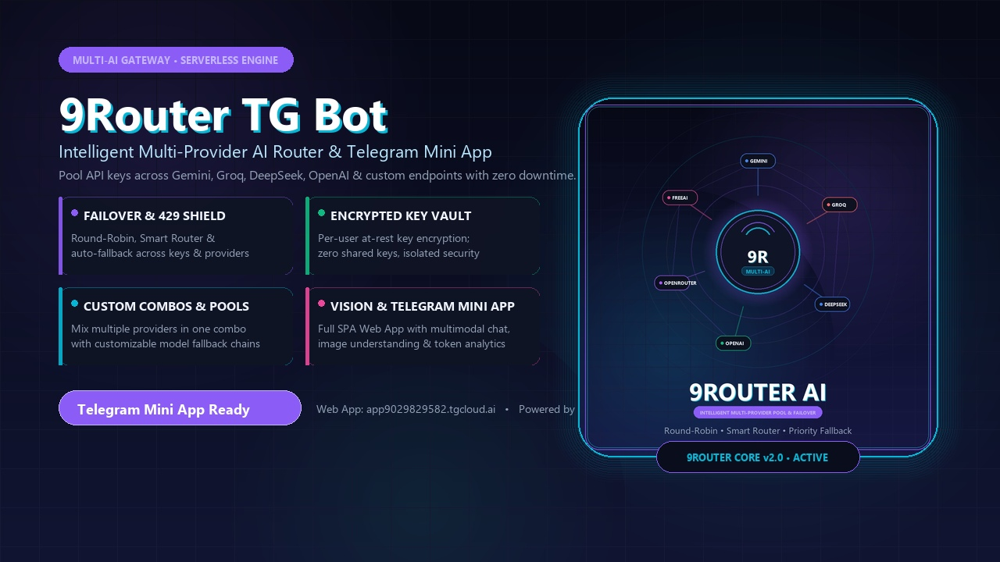

# 9Router TG Bot ⚡

<p align="center">
  
</p>

<p align="center">
  <b>Universal Multi-Provider AI Gateway & Telegram Mini App</b><br>
  <i>Pool API keys across Gemini, Groq, DeepSeek, OpenAI & custom endpoints with intelligent load balancing, zero downtime, and client-isolated key encryption.</i>
</p>

<p align="center">
  <a href="https://github.com/mohsen-niksirat/9router_TG_Bot/blob/master/LICENSE"></a>
  <a href="https://tgcloud.ai"></a>
  <a href="https://telegram.org"></a>
  
  
</p>

---

## 🌐 Languages / زبان‌ها
- [English Documentation](#-english-documentation)
- [راهنمای فارسی (Persian Documentation)](#-راهنمای-فارسی)

---

# 🇬🇧 English Documentation

**9Router TG Bot** is an open-source, serverless Telegram bot and high-performance **Telegram Mini App (Web App)** designed to solve API rate-limits, vendor lock-in, and downtime by mimicking an intelligent multi-provider routing layer (similar to 9router/OpenRouter).

Each user can store their own private API keys (securely encrypted at rest), organize keys into priority pools, create custom multi-model **Combos**, and chat with vision/multimodal capabilities directly inside Telegram or via a glassmorphic Web App.

---

### 🚀 Key Features

- **🛡️ 4 Routing Policies & 429 Failover:**
  - `Fallback (Priority)`: Calls key #1; on HTTP `429`, `500`, or `404`, automatically fails over to key #2 or next provider.
  - `Round-Robin`: Distributes load equally across keys within the provider pool.
  - `Smart Router`: Prioritizes the fastest provider/key with the lowest measured latency.
  - `Least Used`: Automatically selects the key with the lowest token / request count.
- **🔐 Client-Isolated Encrypted Key Vault:**
  - Keys are encrypted at rest with symmetric keystream ciphers. No shared pools; every user owns and controls their own keys.
- **🔀 Custom Combos & Model Chains:**
  - Combine multiple providers into a single unified virtual model.
  - Configure candidate fallback models per provider (e.g., `gemini-2.5-flash -> gemini-2.5-pro -> gpt-4o-mini`).
- **👁️ Multimodal Vision Support:**
  - Send photos and images with prompts; the router automatically transforms them into provider-native payloads (OpenAI Vision, Gemini InlineData).
- **📱 Telegram Mini App (Web App):**
  - Modern, responsive SPA with dark glassmorphic UI.
  - Dedicated tabs: **Chat** (with image attachments), **Combos** (interactive builder), **Keys** (vault management & reordering), and **Settings** (analytics & model manager).
- **⚡ Serverless tgcloud Architecture:**
  - Runs natively on `@tgcloud/bot` edge runtime with zero server maintenance, built-in SQLite persistence, and instant deployment.

---

### 📐 Architecture Overview

```mermaid
flowchart TD
    User([Telegram User / Mini App]) --> Webhook[tgcloud Serverless Edge]
    Webhook --> Router[9Router Engine]
    
    subgraph Security & Storage
        Vault[(Encrypted Key Vault)]
        History[(Chat History & Analytics)]
        Combos[(Combo Definitions)]
    end
    
    Router <--> Security & Storage
    
    subgraph Routing Policies
        P1[🛡️ Priority Fallback]
        P2[🔄 Round-Robin]
        P3[⚡ Smart Router]
        P4[⚖️ Least Used]
    end
    
    Router --> Policies[Policy Executor]
    Policies --> P1 & P2 & P3 & P4
    
    subgraph AI Providers
        G[Google Gemini]
        GQ[Groq Cloud]
        DS[DeepSeek]
        OAI[OpenAI]
        OR[OpenRouter]
        CUSTOM[Custom / FreeAI / Manus]
    end
    
    P1 & P2 & P3 & P4 --> AI Providers
```

---

### 📦 Quick Start & Deployment

#### 1. Clone Repository
```bash
git clone https://github.com/mohsen-niksirat/9router_TG_Bot.git
cd 9router_TG_Bot
npm install
```

#### 2. Configure tgcloud
Set your tgcloud token (from [tgcloud.ai](https://tgcloud.ai) dashboard):
```bash
# Windows PowerShell
$env:TGCLOUD_TOKEN = "appXXXXX:YOUR_TOKEN"

# Linux / macOS
export TGCLOUD_TOKEN="appXXXXX:YOUR_TOKEN"
```

#### 3. Database Migration
Apply schema tables (`users`, `user_providers`, `user_keys`, `combos`, `chat_history`, `token_usage`):
```bash
npx tgcloud migrate --safe
```

#### 4. Deploy Code & Mini App
```bash
npx tgcloud push
```

Your bot and Mini App will be live at:
`https://app<YOUR_APP_ID>.tgcloud.ai/`

---

### 🤖 BotFather Setup Commands

Send these commands to [@BotFather](https://t.me/BotFather):

#### `/setcommands`
```text
start - 🚀 شروع ربات و نمایش منوی اصلی
new - 🧹 پاکسازی حافظه و شروع چت جدید
keys - 🔑 مدیریت و افزودن کلیدهای API
combos - 🔀 ساخت و انتخاب کمبوهای ترکیبی
providers - 🏢 مدیریت ارائه‌دهنده‌ها و مدل‌ها
stats - 📊 مشاهده آمار توکن‌ها و مصرف
help - ℹ️ راهنمای کامل استفاده از ربات
```

#### `/setdescription`
```text
🤖 ربات هوشمند 9Router TG Bot
مسیریاب هوشمند چند ارائه‌دهنده‌ای هوش مصنوعی در تلگرام

ویژگی‌ها:
✨ اتصال به Gemini، Groq، DeepSeek، OpenAI و ارائه‌دهنده‌های سفارشی
🛡️ مدیریت و بالانس خودکار کلیدها (Round-Robin، Fallback و Smart Router)
🔐 رمزنگاری کامل کلیدهای اختصاصی هر کاربر
🔀 ساخت کمبوهای ترکیبی با مدل‌های جایگزین
📱 دارای مینی‌اپ اختصاصی چت چندرسانه‌ای با قابلیت ارسال عکس
```

#### `/setabouttext`
```text
Intelligent Multi-Provider AI Router with Encrypted Key Vault, Custom Combos, Multimodal Vision, and a full Telegram Mini App. Powered by tgcloud.
```

#### `/setmenubutton`
Configure the Web App button:
- **Button URL:** `https://app9029829582.tgcloud.ai/`
- **Button Text:** `🚀 باز کردن مینی‌اپ` (Open Mini App)

---

# 🇮🇷 راهنمای فارسی

**ربات 9Router TG Bot** یک دستیار هوشمند تلگرامی و **مینی‌اپ اختصاصی (Telegram Mini App)** است که با الهام از معماری پیشرفته سرویس‌هایی نظیر 9router و OpenRouter پیاده‌سازی شده است. این سیستم به کاربران اجازه می‌دهد کلیدهای API اختصاصی خود را اضافه کرده و بدون نگرانی از محدودیت سهمیه (Rate-Limit 429) یا قطعی سرویس‌دهنده‌ها، چت پایدار و بی‌وقفه داشته باشند.

---

### ✨ قابلیت‌ها و امکانات برجسته

1. **🛡️ ۴ سیاست هوشمند مسیریابی و بالانس بار:**
   - **فالبک اولویتی (Priority Fallback):** تلاش با کلید اول؛ در صورت دریافت خطای `429`، `500` یا `404`، به سرعت روی کلیدهای بعدی یا ارائه‌دهنده‌های جایگزین سوئیچ می‌کند.
   - **راند رابین (Round-Robin):** تقسیم عادلانه درخواست‌ها بین تمام کلیدهای فعال یک ارائه‌دهنده.
   - **روتر هوشمند (Smart Router):** ارزیابی پینگ و زمان پاسخ ارائه‌دهنده‌ها و هدایت درخواست به سریع‌ترین ارائه‌دهنده.
   - **کمترین استفاده (Least Used):** انتخاب کلیدی که کمترین میزان توکن و درخواست را مصرف کرده است.
2. **🔐 گاوصندوق رمزنگاری‌شده کلیدها (Vault):**
   - کلیدهای هر کاربر در دیتابیس به صورت کاملاً ایزوله و با الگوریتم متقارن رمزنگاری می‌شوند و هیچ کاربری به کلیدهای دیگری دسترسی ندارد.
3. **🔀 کمبوهای اختصاصی و زنجیره مدل‌ها (Combos):**
   - امکان ترکیب چند ارائه‌دهنده در قالب یک پکیج واحد (مثلاً Gemini + Groq).
   - تعریف مدل‌های اولویت‌دار و مدل‌های پشتیبان به ازای هر ارائه‌دهنده (جدا شده با خط جدید یا کاما).
4. **👁️ بینایی ماشین و چت چندرسانه‌ای (Multimodal Vision):**
   - ارسال تصاویر به همراه دستور متنی؛ ربات به صورت خودکار تصویر را به فرمت استاندارد مدل مقصد (OpenAI Vision یا Gemini Inline Data) تبدیل و پاسخ تحلیلی ارائه می‌دهد.
5. **📱 مینی‌اپ تلگرام مدرن و راست‌چین (RTL):**
   - محیط چت شیشه‌ای (Glassmorphic) دارک با ۴ بخش مجزا: چت، کمبوها، کلیدها، و تنظیمات/آمار توکن‌ها.
6. **⚙️ افزودن ارائه‌دهنده‌های دلخواه:**
   - سازگار با تمام APIهای استاندارد OpenAI (نظیر OpenRouter، Together AI، FreeAI، Manus، و هاست‌های محلی Ollama/vLLM).

---

### 🗂️ ساختار پروژه

```text
9router_TG_Bot/
├── assets/                  # بنرها و تصاویر برندینگ
│   ├── avatar.jpg           # تصویر پروفایل با رزولوشن ۱۰۲۴×۱۰۲۴
│   ├── banner.jpg           # بنر توضیحات و پیش‌نمایش ۱۲۸۰×۷۲۰
│   ├── make_avatar.py       # اسکریپت تولید خودکار آواتار با Pillow
│   └── make_banner.py       # اسکریپت تولید خودکار بنر با Pillow
├── dist/                    # سورس مینی‌اپ تلگرام (SPA)
│   └── index.html           # کلاینت تحت وب مدرن با تم دارک و پشتیبانی چندرسانه‌ای
├── tgcloud/                 # هسته پردازشی ربات روی بستر tgcloud
│   ├── endpoints/
│   │   └── api.js           # اندپوینت RESTful برای ارتباط مینی‌اپ
│   ├── handlers/
│   │   ├── message.js       # مدیریت پیام‌ها و ویزارد ساخت ارائه‌دهنده/کمبو
│   │   └── callback_query.js# مدیریت کلیک دکمه‌های شیشه‌ای
│   ├── lib/
│   │   ├── ai_router.js     # هسته مسیریابی و پیاده‌سازی ۴ سیاست
│   │   ├── chat.js          # فرمت‌بندی تاریخچه و مدیریت تصاویر
│   │   ├── crypto.js        # موتور رمزنگاری متقارن کلیدها
│   │   ├── db.js            # لایه ارتباط با دیتابیس SQLite
│   │   ├── keyboards.js     # سازنده کیبوردهای تعاملی تلگرام
│   │   └── providers.js     # کاتالوگ ارائه‌دهنده‌های پیش‌فرض و سیاست‌ها
│   └── schema.js            # جداول دیتابیس
├── tgcloud.jsonc            # پیکربندی استقرار سرورلس tgcloud
└── package.json             # وابستگی‌های پروژه
```

---

### 📄 مجوز و توسعه‌دهنده (License)
این پروژه تحت مجوز **MIT** منتشر شده است. هرگونه استفاده، تغییر و توسعه شخصی یا تجاری آزاد است.
توسعه داده شده توسط [mohsen-niksirat](https://github.com/mohsen-niksirat).
