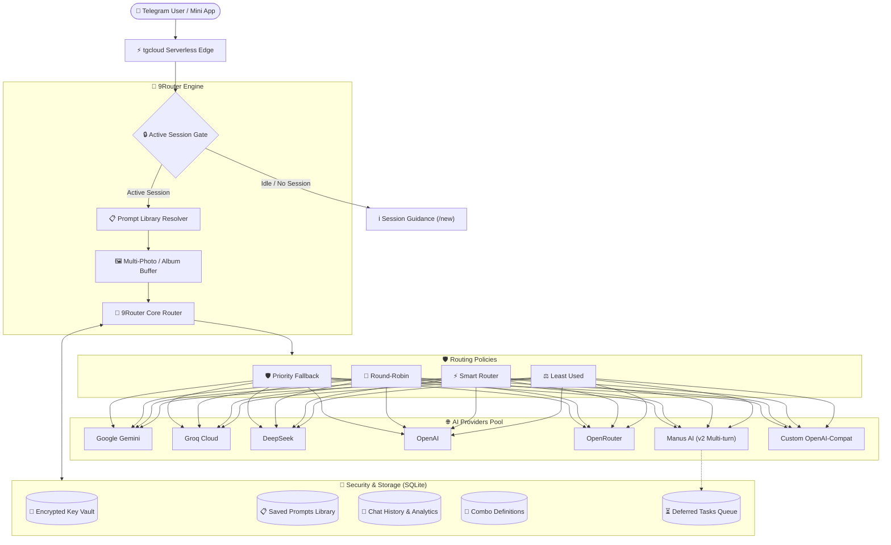

# 9Router TG Bot ⚡

<p align="center">
  
</p>

<p align="center">
  <b>Universal Multi-Provider AI Gateway, Continuous Task Router & Telegram Mini App</b><br>
  <i>Pool API keys across Gemini, Groq, DeepSeek, OpenAI, Manus AI & custom endpoints with intelligent load balancing, multi-turn task continuity, multimodal album support, and client-isolated key encryption.</i>
</p>

<p align="center">
  <a href="https://github.com/mohsen-niksirat/9router_TG_Bot/blob/master/LICENSE"></a>
  <a href="https://tgcloud.ai"></a>
  <a href="https://telegram.org"></a>
  
  
  
</p>

---

## 🌐 Languages / زبان‌ها
- [English Documentation](#-english-documentation)
- [راهنمای فارسی (Persian Documentation)](#-راهنمای-فارسی)

---

# 🇬🇧 English Documentation

**9Router TG Bot** is an open-source, serverless Telegram bot and high-performance **Telegram Mini App (Web App)** designed to solve API rate-limits, vendor lock-in, and service downtime by providing an intelligent multi-provider routing layer (similar to 9router/OpenRouter).

Users can securely store their private API keys (encrypted at rest), organize keys into priority pools, create custom multi-model **Combos**, maintain continuous multi-turn dialogue sessions without cluttering external provider task lists, expand custom saved prompts, and chat with vision/multimodal capabilities directly inside Telegram or via a sleek glassmorphic Web App.

---

### 🚀 Key Features

- **💬 Strict Chat Session Management & Archive Switcher (`/new`, `/chat`, `/end`, `/sessions`):**
  - **Session Isolation:** In normal idle mode, the bot ignores stray inputs to prevent accidental token usage or cluttering external AI task dashboards.
  - **Continuous Dialogue:** Starting a session with `/new`, `/chat`, or inline buttons initiates an ongoing conversation where all follow-up messages and images are linked.
  - **📜 Automatic Archive & Multi-Session Switcher:** Past conversations and Manus tasks are never lost — they are automatically archived into SQLite. Use `/sessions` or `📜 Session Archive` to browse, inspect, and resume previous conversations with complete context.
  - **Graceful Closure:** Tapping `🛑 End Chat` (`/end` or `/stop`) archives the session and finalizes active tasks cleanly.
- **📄 Code & Document File Analyzer:**
  - Send scripts, source files, and datasets (`.py`, `.js`, `.ts`, `.json`, `.txt`, `.html`, `.css`, `.cpp`, `.java`, `.sql`, `.md`, `.csv`, `.log`, `.env`, etc. up to 512KB).
  - Automatically decodes UTF-8 content and wraps it with appropriate language markdown syntax blocks for AI code analysis, debugging, and refactoring.
- **❌ Live Request Cancellation & Ticker Watchdog:**
  - Features a live `❌ Cancel Request` inline button on the "Processing..." indicator.
  - Non-blocking CPU-safe watchdog ticks elapsed seconds every interval without consuming isolate execution budgets.
  - Secure authorization ensures only the request initiator or group admin can cancel the pending task.
- **👥 Group & Supergroup Intelligence & Admin Controls:**
  - **Mention & Reply Detection:** The bot stays quiet in groups, only responding when explicitly tagged (`@bot`), replied to, or addressed with keywords (`bot `, `ai `, `ربات `, `روتر `).
  - **Reply-to-User Analysis:** Tagging the bot in a reply to another member's code, text, or image prompts the AI to analyze that member's content with your instructions.
  - **Privacy Guard:** Management commands (`/keys`, `/combos`, `/start`, `/providers`, `/sessions`, `/stats`) in groups redirect callers to private chat via an inline button to protect API credentials.
  - **Admin Control Suite:** Group administrators can toggle bot silence (`/bot سکوت` / `/bot صحبت`), run health checks (`/bot test`), and view status.
- **🎨 Deep Manus AI Integration & Direct In-Chat Media Delivery:**
  - **Multi-Turn Task Continuity:** Instead of creating dozens of separate tasks on the Manus dashboard, subsequent messages in a session leverage the official `POST /v2/task.sendMessage` endpoint to continue inside the existing task.
  - **Direct Telegram Image Delivery:** AI-generated images and assets are extracted from CDN URLs and delivered directly to your Telegram chat — no external browser visit required!
  - **Asynchronous Result Retrieval:** For complex generative tasks that exceed webhook execution windows, the bot queues deferred tasks (`pending_tasks`) and provides a one-click `🔄 Check & Retrieve Output` button.
- **🖼️ Multimodal Vision & Multi-Photo Albums (`media_group_id`):**
  - Send multiple photos simultaneously (e.g., a landscape background + a portrait photo) along with an instruction prompt.
  - Sibling Telegram photo updates are automatically debounced, buffered in SQLite, and delivered to the AI model as an atomic multimodal payload.
- **📋 Custom Saved Prompt Library (ثبت پرامپت دلخواه):**
  - Overcomes Telegram's 1024-character photo caption limitation.
  - Save comprehensive, highly detailed prompts with short titles (`/prompts` or `📋 My Prompts`).
  - Use `پرامپت [title]` or `#[title]` in messages or captions; the bot automatically expands it into the full prompt before forwarding to the AI.
- **🛡️ 4 Intelligent Routing Policies & Automatic Failover:**
  - `Fallback (Priority)`: Calls key #1; on HTTP `429`, `500`, or `404`, instantly switches to key #2 or next provider in chain.
  - `Round-Robin`: Distributes load equally across keys within the provider pool.
  - `Smart Router`: Prioritizes the provider/key with the lowest measured error and failure rate.
  - `Least Used`: Automatically selects the key with the lowest token / request count.
- **🔐 Client-Isolated Encrypted Key Vault:**
  - Keys are encrypted at rest with an isolated per-install random secret plus a fresh IV per ciphertext (pure-JS keystream cipher) — never derived from public IDs.
- **🔀 Custom Combos & Model Chains:**
  - Combine multiple providers into a single virtual routing preset.
  - Configure fallback models per provider (e.g., `gemini-2.5-flash -> gemini-2.5-pro -> gpt-4o-mini`).
- **📱 Telegram Mini App (Web App):**
  - Modern, responsive SPA with dark glassmorphic UI.
  - 4 tabs: **Chat** (multimodal with attachments), **Combos** (interactive builder), **Keys** (vault management & priority reordering), and **Settings** (analytics & model manager).
- **⚡ Serverless tgcloud Architecture:**
  - Runs natively on `@tgcloud/bot` edge runtime with zero server maintenance, built-in SQLite persistence, and instant deployment.

---

### 📐 Architecture Overview



---

### 📦 Quick Start & Deployment

#### 1. Clone Repository
```bash
git clone https://github.com/mohsen-niksirat/9router_TG_Bot.git
cd 9router_TG_Bot
npm install
```

#### 2. Configure tgcloud
Set your tgcloud token (obtained from your [tgcloud.ai](https://tgcloud.ai) dashboard):
```bash
# Windows PowerShell
$env:TGCLOUD_TOKEN = "appXXXXX:YOUR_TOKEN"

# Linux / macOS
export TGCLOUD_TOKEN="appXXXXX:YOUR_TOKEN"
```

#### 3. Database Migration
Apply schema tables (`users`, `user_providers`, `user_keys`, `combos`, `chat_history`, `token_usage`, `media_group_buffer`, `chat_claims`, `config`, `pending_tasks`, `saved_prompts`):
```bash
npx tgcloud migrate --safe
```

#### 4. Deploy Code & Mini App
```bash
npx tgcloud push
```

Your bot and Mini App will be immediately live at:
`https://app<YOUR_APP_ID>.tgcloud.ai/`

---

### 🤖 BotFather Setup Commands

Send these commands to [@BotFather](https://t.me/BotFather):

#### `/setcommands`
```text
start - 🚀 شروع ربات و نمایش منوی اصلی
new - 💬 شروع چت جدید (گفتگوی پیوسته)
end - 🛑 پایان مکالمه جاری و بستن تسک
sessions - 📜 مشاهده و بازیابی آرشیو گفتگوها
prompts - 📋 کتابخانه پرامپت‌های ذخیره‌شده
keys - 🔑 مدیریت و افزودن کلیدهای API
combos - 🔀 ساخت و انتخاب کمبوهای ترکیبی
providers - 🌐 مدیریت ارائه‌دهنده‌ها و مدل‌ها
stats - 📊 مشاهده آمار توکن‌ها و مصرف
help - ℹ️ راهنمای کامل استفاده از ربات
```

#### `/setdescription`
```text
🤖 ربات هوشمند 9Router TG Bot
مسیریاب هوشمند چند ارائه‌دهنده‌ای هوش مصنوعی با پشتیبانی از مانوس، کمبوهای ترکیبی، مکالمه پیوسته، گاوصندوق کلیدها، پردازش آلبوم عکس و مینی‌اپ اختصاصی.
```

#### `/setabouttext`
```text
Universal Multi-Provider AI Router with Encrypted Key Vault, Custom Combos, Manus AI v2 continuity, Multimodal Albums, and Telegram Mini App. Powered by tgcloud.
```

#### `/setmenubutton`
Configure the Web App button:
- **Button URL:** `https://app<YOUR_APP_ID>.tgcloud.ai/`
- **Button Text:** `🚀 باز کردن مینی‌اپ` (Open Mini App)

---

# 🇮🇷 راهنمای فارسی

**ربات 9Router TG Bot** یک دستیار هوشمند تلگرامی و **مینی‌اپ اختصاصی (Telegram Mini App)** است که با الهام از معماری پیشرفته سرویس‌هایی نظیر 9router و OpenRouter پیاده‌سازی شده است. این سیستم به شما امکان می‌دهد کلیدهای API اختصاصی خود را اضافه کرده، بدون نگرانی از محدودیت سهمیه (Rate-Limit 429) یا قطعی سرویس‌دهنده‌ها چت کنید، با **هوش مصنوعی مانوس (Manus AI)** گفتگوی ادامه‌دار داشته باشید و تصاویر خروجی را مستقیماً داخل چت تلگرام دریافت نمایید.

---

### ✨ قابلیت‌ها و امکانات برجسته

1. **💬 مدیریت سشن، گفتگوی پیوسته و آرشیو هوشمند (Chat Session & Switcher):**
   - **قفل ورودی در حالت عادی:** برای جلوگیری از ایجاد تسک‌های ناخواسته و مصرف بیهوده توکن، پیام‌های عادی تا زمانی که چت فعال نباشد پردازش نمی‌شوند و ربات کاربر را برای باز کردن چت راهنمایی می‌کند.
   - **شروع چت با یک لمس:** با زدن دکمه‌ی «💬 شروع چت جدید» یا دستور `/new` / `/chat` یک سشن فعال باز می‌شود.
   - **📜 آرشیو و سوئیچر گفتگوها (`/sessions` یا `/history`):** با شروع چت جدید یا زدن پایان مکالمه، گفتگوها و تسک‌های مانوس به صورت خودکار در دیتابیس آرشیو می‌شوند. می‌توانید در هر زمان با دستور `/sessions` یا دکمه «📜 آرشیو گفتگوها» لیست سشن‌ها را ببینید و با یک لمس گفتگو را با تمام حافظه و تسک قبلی بازیابی و ادامه دهید.
   - **پایان تمیز مکالمه:** با زدن دکمه‌ی «🛑 پایان مکالمه» یا دستور `/end`، سشن به صورت خودکار آرشیو شده و تسک جاری بسته می‌شود.

2. **📄 آنالیزور سورس‌کد و فایل‌های متنی (Code & Document Analyzer):**
   - ارسال مستقیم فایل‌های سورس کد (`.py`, `.js`, `.ts`, `.json`, `.txt`, `.html`, `.css`, `.cpp`, `.java`, `.sql`, `.md`, `.csv`, `.log`, `.env` تا سقف ۵۱۲ کیلوبایت).
   - استخراج محتوا و فرمت‌بندی هوشمند در بلاک‌های Markdown کد همراه با نام زبان برای ریفکتور، تحلیل خطاها و پاسخ جامع هوش مصنوعی.

3. **❌ لغو زنده درخواست (Live Cancel) و تایمر ثانیه‌شمار واچ‌داگ:**
   - دکمه شیشه‌ای «❌ لغو درخواست» روی پیام در حال پردازش.
   - واچ‌داگ بهینه که ثانیه‌های سپری‌شده را به صورت بلادرنگ گزارش می‌دهد بدون اینکه منابع CPU سرورلس را بسوزاند.
   - گیت امنیتی جهت اطمینان از اینکه فقط آغازکننده درخواست یا ادمین گروه حق لغو را دارد.

4. **👥 هوش گروهی و سوپرگروه همراه با کنترل اختصاصی ادمین:**
   - **پاسخ‌دهی هوشمند بر اساس منشن یا ریپلای:** در گروه‌ها ربات سکوت اختیار می‌کند و تنها در صورت تگ شدن (`@botname`)، ریپلای به پیام ربات، یا پیشوندهای `bot `، `ai `، `ربات `، `روتر ` پاسخ می‌دهد.
   - **آنالیز ریپلای به پیام دیگران:** اگر پیام، تصویر یا فایل کد کاربری را ریپلای کرده و ربات را صدا بزنید، هوش مصنوعی محتوای پیام او را با دستور شما آنالیز می‌کند.
   - **محافظت از حریم خصوصی کلیدها:** منوهای خصوصی (`/keys`، `/combos`، `/stats`، `/start`، `/sessions`) در گروه نمایش داده نمی‌شوند و با دکمه شیشه‌ای کاربر را به پیوی هدایت می‌کنند.
   - **فرمان‌های مدیریتی ادمین گروه:** `/bot سکوت` (بی‌صدا کردن موقت ربات در گروه)، `/bot صحبت` (فعال‌سازی مجدد)، و `/bot test` (بررسی وضعیت اتصال).

5. **🎨 اتصال مستقیم به Manus AI و دریافت خروجی داخل تلگرام:**
   - **ارسال به همان تسک قبلی (`task.sendMessage`):** بر خلاف روال معمول که هر پیام یک تسک جدید باز می‌کند، در این ربات تمامی پیام‌ها و تصاویر یک سشن به همان تسک قبلی مانوس ارسال می‌شوند تا فهرست تسک‌های وب‌سایت شلوغ نشود.
   - **تحویل مستقیم تصویر و متن در چت:** تصاویر تولیدشده توسط مانوس مستقیماً استخراج شده و به همراه کپشن کامل به چت تلگرام ارسال می‌گردند و نیازی به باز کردن سایت مانوس نیست.
   - **صف پس‌زمینه تسک‌های سنگین:** در صورت طولانی شدن پردازش، تسک در صف `pending_tasks` ذخیره شده و با دکمه‌ی شیشه‌ای `🔄 دریافت تصویر و نتیجه نهایی` یا با اولین پیام بعدی به صورت خودکار تحویل داده می‌شود.

6. **🖼️ ارسال همزمان چند عکس (آلبوم) در قالب یک پیام:**
   - پشتیبانی کامل از آلبوم‌های چندعکسی تلگرام (`media_group_id`).
   - می‌توانید چندین عکس (مثلاً عکس یک منظره و عکس قدی یک شخص) را با هم ارسال کرده و از مدل بخواهید آن‌ها را ادغام یا ویرایش کند؛ ربات تمام تصاویر را در قالب یک پیام یکپارچه به هوش مصنوعی تحویل می‌دهد.

7. **📋 کتابخانه ثبت پرامپت دلخواه (حل محدودیت کپشن تلگرام):**
   - تلگرام برای کپشن عکس‌ها محدودیت کاراکتر دارد؛ با استفاده از منوی «📋 پرامپت‌های من» یا دستور `/prompts` می‌توانید پرامپت‌های جامع و بسیار طولانی را با یک عنوان کوتاه (مثلاً `عکس گچی`) ذخیره کنید.
   - دفعه بعد هنگام ارسال عکس، کافی است عبارت `پرامپت عکس گچی` یا `#عکس گچی` را بنویسید؛ ربات متن کامل پرامپت را به طور خودکار جایگزین کرده و به مدل ارسال می‌کند.

8. **🛡️ ۴ سیاست هوشمند مسیریابی و بالانس بار:**
   - **فالبک اولویتی (Priority Fallback):** تلاش با کلید اول؛ در صورت دریافت خطای `429`، `500` یا `404`، بلافاصله روی کلیدهای بعدی یا ارائه‌دهنده‌های جایگزین سوئیچ می‌کند.
   - **راند رابین (Round-Robin):** توزیع چرخشی درخواست‌ها بین کلیدهای فعال.
   - **روتر هوشمند (Smart Router):** ارزیابی درصد موفقیت کلیدها و هدایت درخواست به سالم‌ترین کلید.
   - **کمترین مصرف (Least Used):** انتخاب کلیدی با کمترین تعداد توکن مصرف‌شده.

9. **🔐 گاوصندوق رمزنگاری‌شده کلیدها (Vault):**
   - کلیدها با کلید تصادفی منحصر‌به‌فرد سرور و IV مجزا به صورت رمزنگاری‌شده ذخیره می‌شوند و هرگز به صورت متن ساده در دیتابیس قرار نمی‌گیرند.

10. **📱 مینی‌اپ تلگرام مدرن و دارک (RTL Mini App):**
    - محیط چت تحت وب شیشه‌ای با دسترسی سریع به مدیریت کلیدها، ساخت کمبو، چت چندرسانه‌ای و گزارش آماری توکن‌ها.

---

### 🗂️ ساختار فایل‌های پروژه

```text
9router_TG_Bot/
├── assets/                  # بنرها و تصاویر برندینگ
│   ├── avatar.jpg           # تصویر پروفایل با رزولوشن ۱۰۲۴×۱۰۲۴
│   ├── banner.jpg           # بنر توضیحات و پیش‌نمایش ۱۲۸۰×۷۲۰
│   ├── make_avatar.py       # اسکریپت ساخت آواتار
│   └── make_banner.py       # اسکریپت ساخت بنر
├── dist/                    # مینی‌اپ تلگرام (Single Page Application)
│   └── index.html           # کلاینت تحت وب با تم دارک و ارتباط REST
├── tgcloud/                 # هسته پردازشی ربات روی بستر tgcloud
│   ├── endpoints/
│   │   └── api.js           # اندپوینت RESTful ارتباط مینی‌اپ با سرور
│   ├── handlers/
│   │   ├── message.js       # پردازش پیام‌ها، فیلتر سشن، پرامپت‌ها و آلبوم
│   │   └── callback_query.js# پردازش دکمه‌های شیشه‌ای و چک تسک‌های مانوس
│   ├── lib/
│   │   ├── ai_router.js     # هسته مسیریابی، مانوس v2 و ۴ سیاست بالانس
│   │   ├── chat.js          # فرمت‌بندی تاریخچه، سشن و تجمیع چند عکس
│   │   ├── config.js        # تنظیمات و کلید‌های سیستمی
│   │   ├── crypto.js        # رمزنگاری کلیدها با Secret و IV
│   │   ├── db.js            # لایه تعامل با جداول دیتابیس SQLite
│   │   ├── keyboards.js     # ساخت کیبوردهای پویا و نوار دسترسی سریع
│   │   ├── manus_pending.js # صف تحویل تسک‌های مانوس در چت تلگرام
│   │   ├── providers.js     # ارائه‌دهنده‌های پیش‌فرض و سیاست‌های بالانس
│   │   └── sleep.js         # وقفه‌های ایمن سازگار با محیط ایزوله سرورلس
│   └── schema.js            # جداول SQLite (کاربران، کلیدها، پرامپت‌ها، تسک‌ها)
├── tgcloud.jsonc            # پیکربندی استقرار سرورلس tgcloud
└── package.json             # پکیج و اسکریپت‌های پروژه
```

---

### 📄 مجوز و توسعه‌دهنده (License)

این پروژه تحت مجوز **MIT** منتشر شده است. هرگونه استفاده، تغییر و توسعه شخصی یا تجاری کاملاً آزاد است.  
توسعه داده شده توسط [mohsen-niksirat](https://github.com/mohsen-niksirat).
